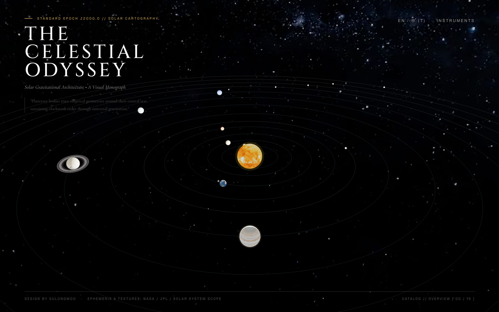
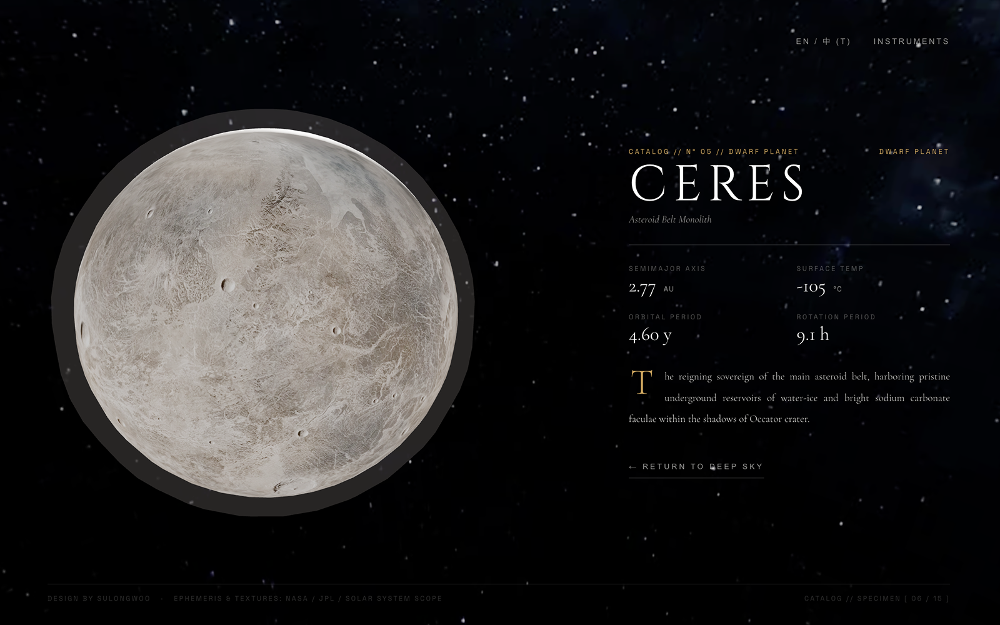

# The Celestial Odyssey

A solar system you can hold in your hand, typeset like an astronomy magazine. Drag, click and zoom your way between the star field and the editorial columns — no install, no build step.



Live: <https://sulongwooo.github.io/the_celestial_odyssey/>

---

## What it is

A WebGL-rendered, interactive atlas of the solar system: the Sun, the eight planets, the Moon and five dwarf planets (Ceres, Pluto, Haumea, Makemake and Eris), each placed in true orbital order with real texture maps. The visual language borrows from print magazines — an oversized masthead, editorial columns and an issue folio — instead of the usual dashboard-style infographic.

## What you can do

- **Overview** — all bodies orbit slowly along their paths; scroll to zoom in, drag to change the viewing angle.
- **Click a body** — the camera docks to the left side of the frame and a feature column slides in on the right, with semi-major axis, surface temperature, orbital and rotational periods plus bilingual (English / 中文) commentary.
- **Observation console** — toggle the star field, orbit lines, revolution and rotation, and set the time scale with a slider (up to 3.0×).
- **Bilingual** — every section, the folio and all body entries ship in both English and Chinese; press `T` to switch.

### The feature column

On click, the camera position is computed from the viewing frustum so the selected body sits clear of the panel; the remaining bodies and orbit lines fade out, leaving the layout to the data and the text.



| Input | Action |
| --- | --- |
| Drag | Orbit the camera |
| Scroll | Zoom in / out |
| Click a body | Open its feature column |
| Click empty space | Return to the overview |
| `←` / `→` | Previous / next body (focus mode only) |
| `ESC` | Return to the overview |
| `T` | Toggle English / Chinese |

## Run locally

Option 1: open `index.html` directly in a browser.

Option 2: serve it over a static server (recommended — textures load more reliably):

```bash
python3 -m http.server 8123
```

Then open <http://localhost:8123>.

## Project structure

```
the_celestial_odyssey/
├── index.html              # The whole page: styles and logic are inlined
├── assets/
│   ├── lib/                # Three.js r128 + OrbitControls, vendored (no CDN)
│   └── textures/           # 20 texture maps: 2K bodies and the star field
├── .github/                # README previews: overview and feature column
├── LICENSE
└── 无用/                   # Archived drafts, git-ignored and not in the repo
```

## Deploy to GitHub Pages

1. In **Settings → Pages**, set Source to **Deploy from a branch**.
2. Pick branch `main` and folder `/ (root)`, then save.
3. After a minute or two, visit `https://<username>.github.io/the_celestial_odyssey/`.

The page is plain static files — no build step, no backend.

## Tech & credits

- **Rendering** — Three.js r128 + WebGL, plain JavaScript, no framework and no build tool.
- **Type** — Cinzel, Cormorant Garamond, Space Grotesk and Noto Serif SC via Google Fonts; falls back to system serif/sans-serif fonts when offline.
- **Dependencies** — Three.js and OrbitControls are vendored under `assets/lib`, so the scene runs without a network connection.
- **Textures & data** — NASA / JPL public data; textures from [Solar System Scope](https://www.solarsystemscope.com/textures/) (CC BY 4.0).

## License

MIT License © 2026 sulongwooo
